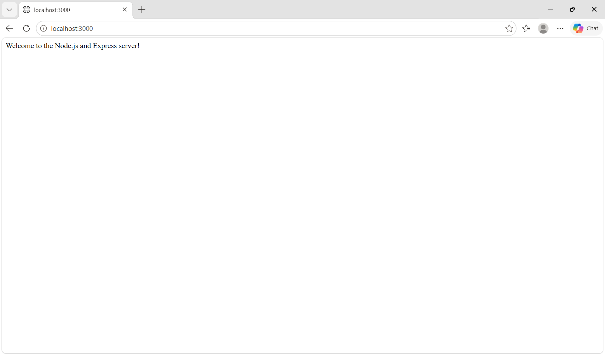
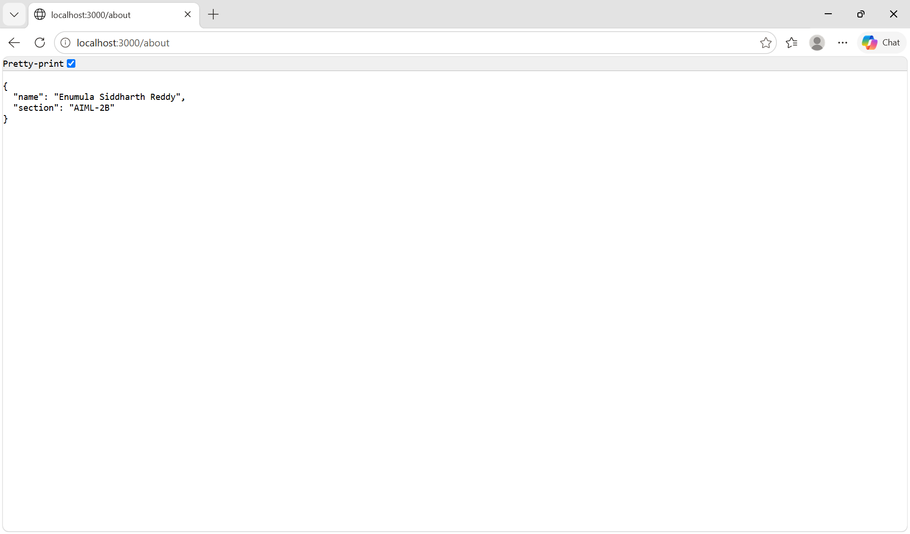
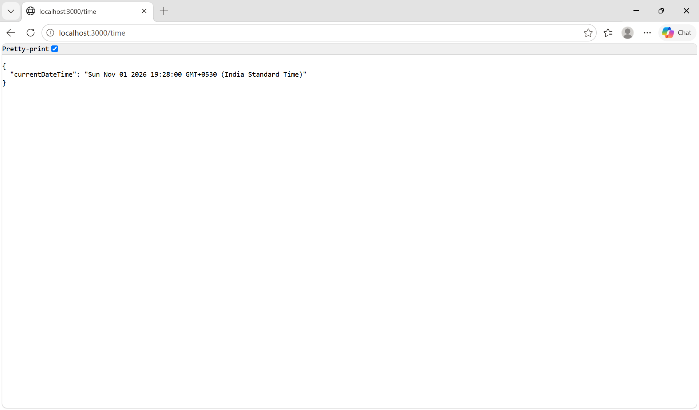

# Lab 1: Node.js and Express server

**Name:Enumula Siddharth Reddy
**Registration number:** Add your registration number  
**Section:** AIML-2B

## Objective

Set up a Node.js project, create a basic web server using Node.js' built-in `http` module, and build the same server using Express.

## Project structure

```text
lab-01-node-express/
├── screenshots/
│   ├── home.png
│   ├── about.png
│   ├── time.png
│   └── not-found.png
├── .gitignore
├── http-server.js
├── package.json
├── package-lock.json
├── README.md
└── server.js
```

`node_modules/` is created automatically after installing dependencies and should not be committed to GitHub.

## Requirements

- Node.js and npm installed
- A web browser

## Installation and running

1. Open a terminal in the folder containing `package.json`.
2. Install dependencies:

   ```bash
   npm install
   ```

   On Windows PowerShell, if the `npm` command is blocked by the execution policy, use:

   ```powershell
   npm.cmd install
   ```

3. Start the Express server:

   ```bash
   npm start
   ```

   On Windows PowerShell, use `npm.cmd start` if `npm start` is blocked.

4. Open `http://localhost:3000` in your browser.

The server uses port `3000` by default. If the `PORT` environment variable is set, the Express server uses that port instead.

### Run the built-in Node.js HTTP server

Stop the Express server with `Ctrl+C`, then run:

```bash
npm run start:http
```

On Windows PowerShell, you can use:

```powershell
npm.cmd run start:http
```

The basic HTTP server responds with `Hello` at `http://localhost:3000`. Stop it with `Ctrl+C` before starting the Express server.

## Endpoints

| Method | Path | Description | Expected status |
|---|---|---|---|
| GET | `/` | Displays a welcome message | 200 OK |
| GET | `/about` | Returns the name and section as JSON | 200 OK |
| GET | `/time` | Returns the current date and time as JSON | 200 OK |
| GET | Any unknown path (example: `/test`) | Displays a not-found message | 404 Not Found |

## Screenshots

Take screenshots of the actual responses from your running server and save them in the `screenshots/` folder using these exact filenames. The Markdown below will display them automatically on GitHub once the image files are added.

### 1. Home route — GET /



### 2. About route — GET /about



### 3. Time route — GET /time



### 4. Unknown route — GET /test (404)


> **Important:** The screenshot image files are not pre-filled. Add your own screenshots from the browser after testing each route. Keep the filenames exactly as shown above so the images appear in this README.

## Explanation of `package.json` fields

- `name`: project/package name.
- `version`: current project version.
- `description`: short project description.
- `main`: main entry point of the project.
- `scripts`: shortcut commands such as `npm start`.
- `keywords`: search terms describing the project.
- `author`: project author.
- `license`: project license.
- `dependencies`: packages required by the project, including Express.

## Viva preparation

**1. What is the difference between `package.json` and `node_modules`?**  
`package.json` stores project information, scripts, and dependency requirements. `node_modules` contains the actual installed package files.

**2. What does `app.listen()` do?**  
It starts the Express application and makes it listen for incoming requests on the specified port.

**3. What do request and response represent?**  
The request object contains information about the incoming HTTP request. The response object is used to send data and status codes back to the client.

## Notes: Problems faced and solutions

- **Problem:** PowerShell blocked the `npm.ps1` script because of its execution policy.
- **Solution:** Used the Windows command `npm.cmd` instead, for example `npm.cmd install` and `npm.cmd start`.
- **Problem:** The terminal was initially opened in the outer project folder.
- **Solution:** Changed into the inner `lab-01-node-express` folder, where `package.json` is located.

Add any other issues you faced and how you solved them.

## Deployment

**Live link:** Add your deployed public URL here after deploying the server. If you cannot deploy it, write `Not deployed` and explain why.

## GitHub submission checklist

- [ ] Add your registration number.
- [ ] Run the project and test all four endpoint cases.
- [ ] Add `home.png`, `about.png`, `time.png`, and `not-found.png` to `screenshots/`.
- [ ] Confirm the screenshots appear in the README preview.
- [ ] Add your deployment URL, or explain why deployment was not possible.
- [ ] Do not commit `node_modules/` or `.env`.
- [ ] Push the project to your course GitHub repository in the `lab-01/` folder.

Save your four actual browser screenshots in this folder using these filenames:
home.png       - GET http://localhost:3000/
about.png      - GET http://localhost:3000/about
time.png       - GET http://localhost:3000/time
not-found.png  - GET http://localhost:3000/test (404 response)

The README.md in the project root already contains Markdown image links to these files.
