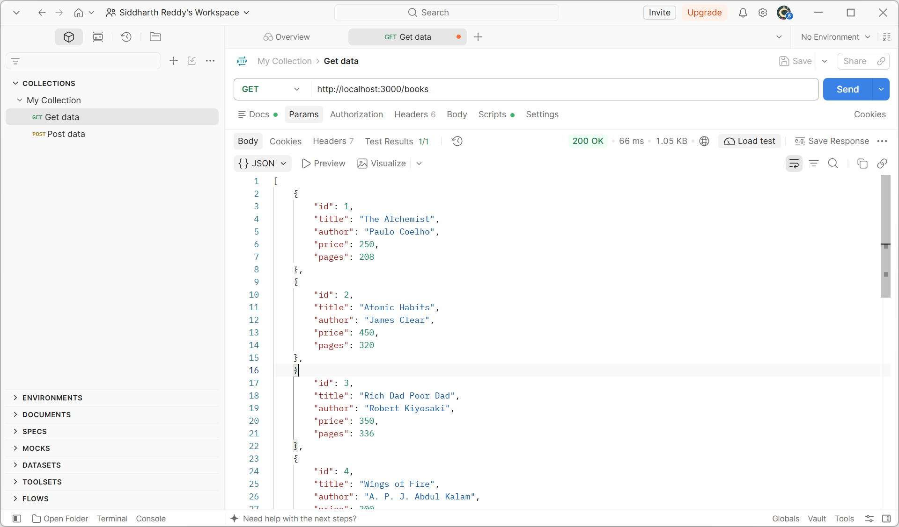
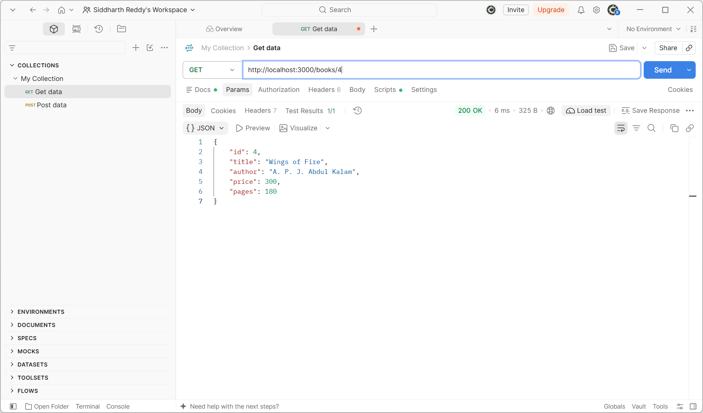
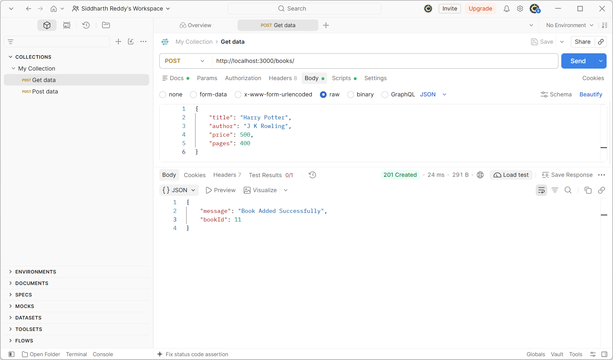
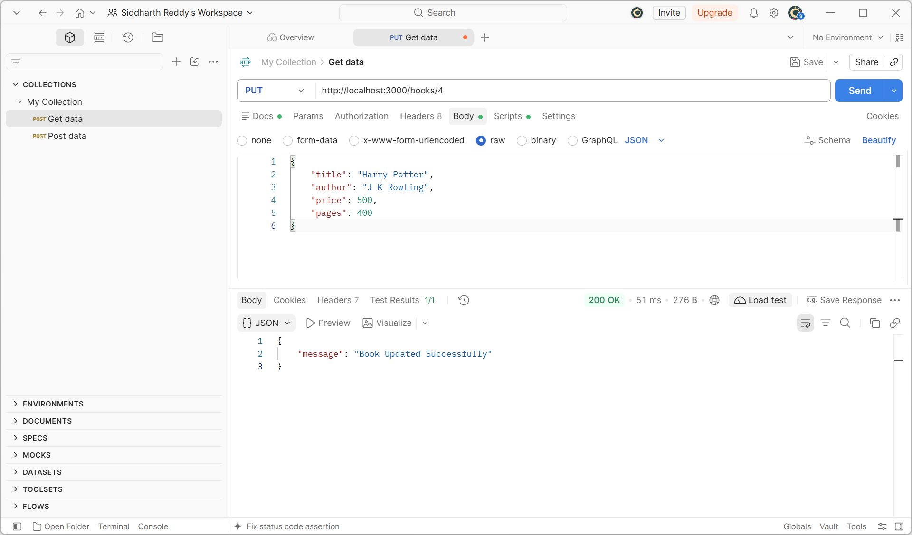
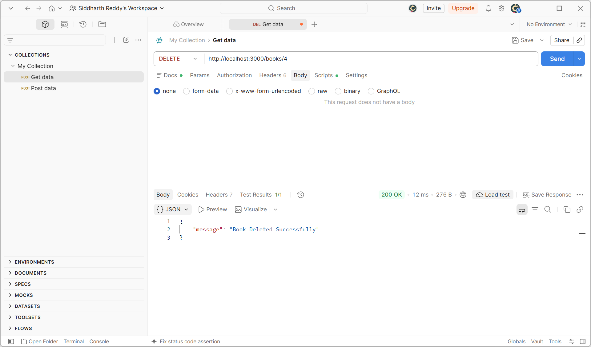

# Lab 2: SQLite Database and CRUD Routes

**Name:** Enumula Siddharth Reddy  
**Registration Number:** 252U1R6064 
**Section:** AIML-2B

**Live link:** Not deployed yet. This project uses a local SQLite database.

## Objective

Connect an Express.js server to an SQLite database and expose Create, Read, Update, and Delete (CRUD) operations over HTTP.

## Technologies Used

- Node.js
- Express.js
- SQLite
- sqlite3
- sqlite
- Nodemon
- Postman

## Installation

Install Node.js, then open a terminal in this folder and run:

```bash
npm install
```

## Database

The `books.db` file is included and contains a `book` table with 10 sample records.

The table has these columns:

| Column | Type |
|---|---|
| id | INTEGER PRIMARY KEY AUTOINCREMENT |
| title | TEXT |
| author | TEXT |
| price | INTEGER |
| pages | INTEGER |

To inspect the database using the SQLite CLI:

```bash
sqlite3 books.db
```

Then run:

```sql
SELECT * FROM book;
```

Exit the SQLite CLI with `.exit`.

## Run the Project

Development mode (automatically restarts after file changes):

```bash
npm run dev
```

Normal start:

```bash
npm start
```

The server runs at `http://localhost:3000/` by default. The `PORT` environment variable can override the port.

## API Endpoints

| Method | Path | Description |
|---|---|---|
| GET | `/books/` | Retrieve all books |
| GET | `/books/:bookId/` | Retrieve one book by ID |
| POST | `/books/` | Add a new book |
| PUT | `/books/:bookId/` | Replace all editable details of a book |
| DELETE | `/books/:bookId/` | Delete a book by ID |

### Example POST / PUT request body

```json
{
  "title": "Harry Potter",
  "author": "J. K. Rowling",
  "price": 500,
  "pages": 400
}
```

All SQL statements that use request input are parameterized with `?` placeholders.

## Screenshots

Add your Postman and SQLite screenshots to this folder. Suggested filenames:

- `screenshots/get-all-books.png`
- `screenshots/get-single-book.png`
- `screenshots/post-book.png`
- `screenshots/put-book.png`
- `screenshots/delete-book.png`
- `screenshots/database.png`












## Problems Faced and Solutions

1. The server must not start before the database connection succeeds. This is handled by awaiting the database initialization before calling `app.listen()`.
2. Parameterized SQL queries with `?` placeholders are used to prevent user input from being interpreted as SQL code.
3. Nodemon is configured as the development command so the server restarts when source files change.

## Conclusion

Successfully connected an Express.js server to SQLite and implemented five CRUD endpoints using parameterized SQL queries.
