# Lab 3: REST API, Query Parameters, Validation and Debugging

**Name:** Enumula Siddharth Reddy  
**Registration Number:** 252U1R6064  
**Section:** AIML-2B

## Overview

A REST API for managing books using Node.js, Express.js and SQLite (via sql.js/WebAssembly). It supports CRUD operations, searching, sorting, price filters, pagination, input validation and appropriate HTTP status codes.

## Requirements

- Node.js 18 or later
- npm
- Postman
- Visual Studio Code

## Installation

```bash
npm install
```

Create a `.env` file by copying `.env.example`. Do not commit `.env`.

## Run

```bash
npm start
```

Open `http://localhost:3000`.

For development:

```bash
npm run dev
```

## Endpoints

| Method | Path | Description |
|---|---|---|
| GET | `/` | API welcome message |
| GET | `/books` | List books with search, sorting, filters and pagination |
| POST | `/books` | Create a book |
| GET | `/books/:id` | Retrieve one book by ID |
| PUT | `/books/:id` | Update an existing book |
| DELETE | `/books/:id` | Delete a book |

## GET /books Query Parameters

| Parameter | Default | Description |
|---|---|---|
| `search_q` | Empty | Partial title search |
| `order_by` | `id` | Sort column |
| `order` | `ASC` | Sort direction (`ASC` or `DESC`) |
| `limit` | `10` | Number of records (maximum 100) |
| `offset` | `0` | Number of records to skip |
| `min_price` | None | Minimum price |
| `max_price` | None | Maximum price |

Example:

```http
GET /books?search_q=python&min_price=200&max_price=800&order_by=price&order=DESC&limit=5&offset=0
```

## Create a Book

Send JSON to `POST /books`:

```json
{
  "title": "Python Basics",
  "author": "John",
  "price": 450
}
```

Expected status: `201 Created`.

## Postman Test List

1. `GET http://localhost:3000/books` — expect 200 OK.
2. `GET http://localhost:3000/books?search_q=python` — expect 200 OK and matching titles.
3. `GET http://localhost:3000/books?order_by=price&order=DESC` — expect 200 OK and descending prices.
4. `GET http://localhost:3000/books?min_price=300&max_price=700` — expect 200 OK and prices in range.
5. `GET http://localhost:3000/books?limit=2&offset=0` — expect 200 OK and at most two records.
6. `POST http://localhost:3000/books` with valid JSON — expect 201 Created.
7. `POST http://localhost:3000/books` with missing title or invalid price — expect 400 Bad Request.
8. `GET http://localhost:3000/books/99999` — expect 404 Not Found if the ID does not exist.
9. `GET http://localhost:3000/books/1` — expect 200 OK if ID 1 exists.
10. `PUT http://localhost:3000/books/6` with valid JSON — expect 200 OK if ID 6 exists.
11. `DELETE http://localhost:3000/books/4` — expect 200 OK if ID 4 exists.
12. `DELETE http://localhost:3000/books/99999` — expect 404 Not Found if the ID does not exist.

## Screenshots

Postman testing screenshots:

### 1. GET - Retrieve All Books

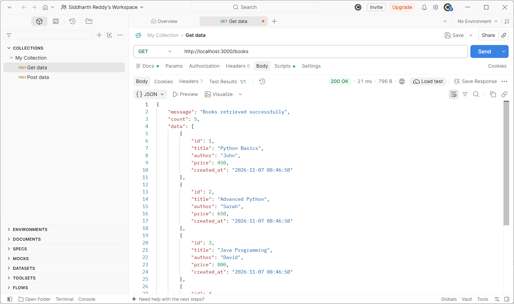

### 2. GET - Search Books

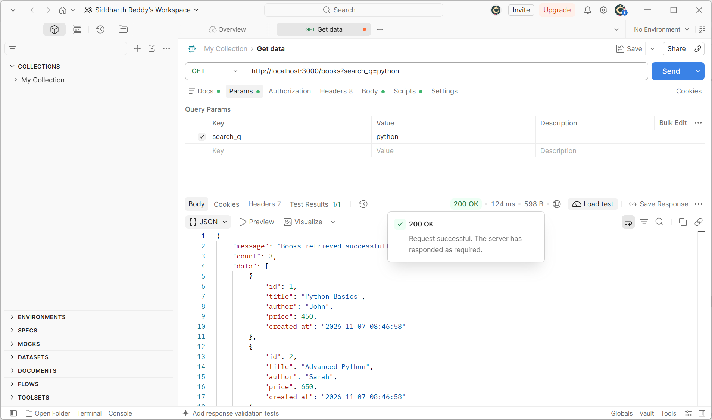

### 3. GET - Sort Books by Price

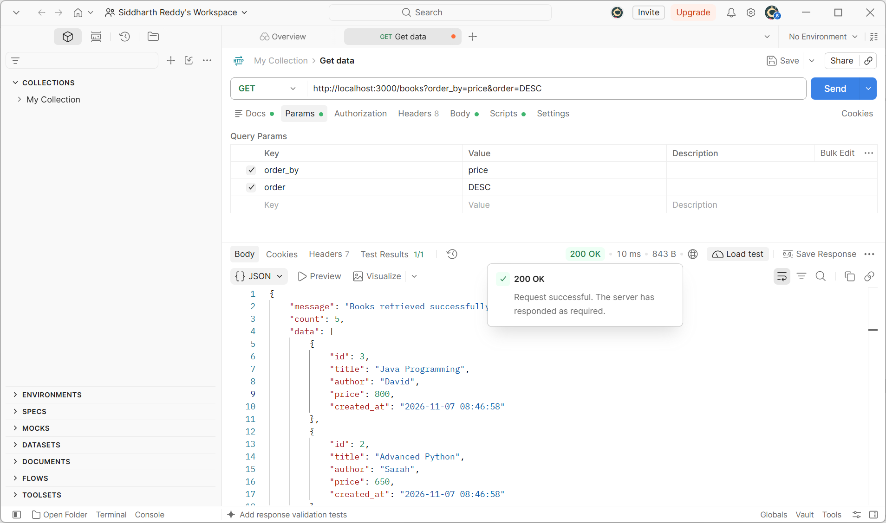

### 4. GET - Filter Books by Price Range

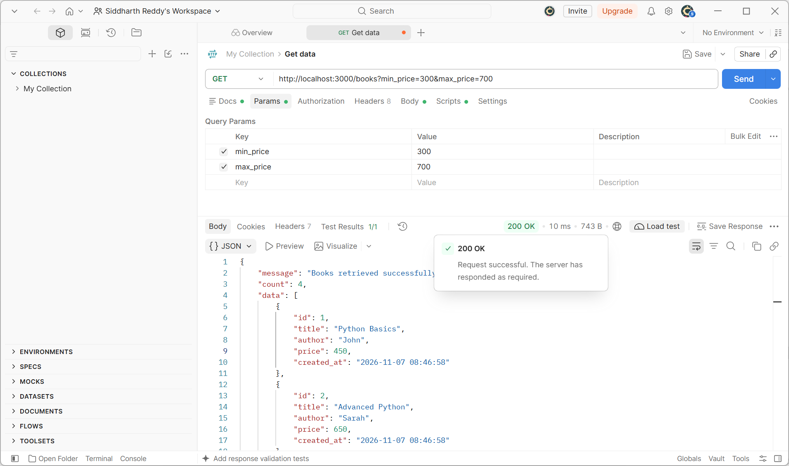

### 5. GET - Pagination

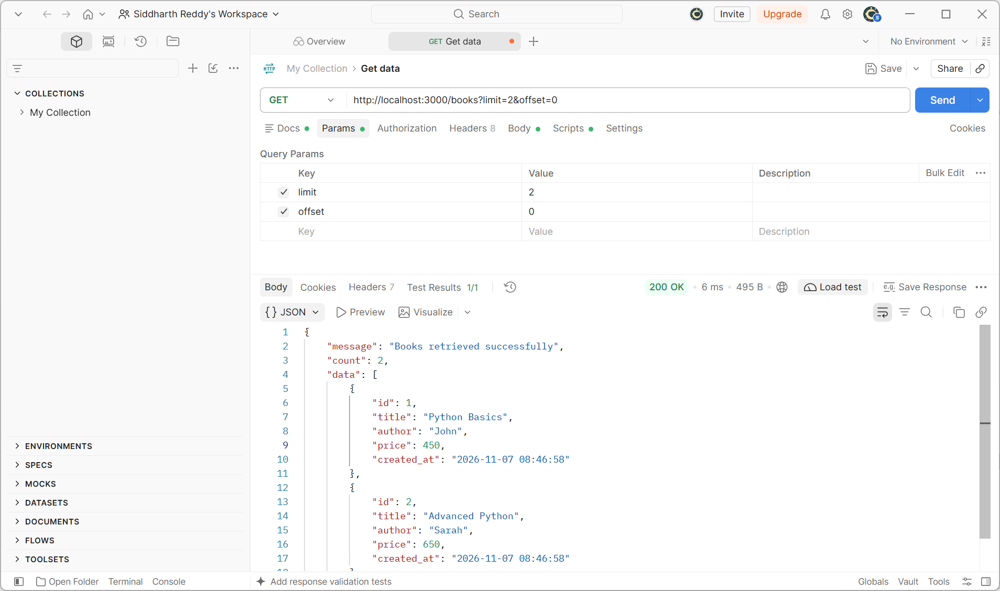

### 6. POST - Add a New Book

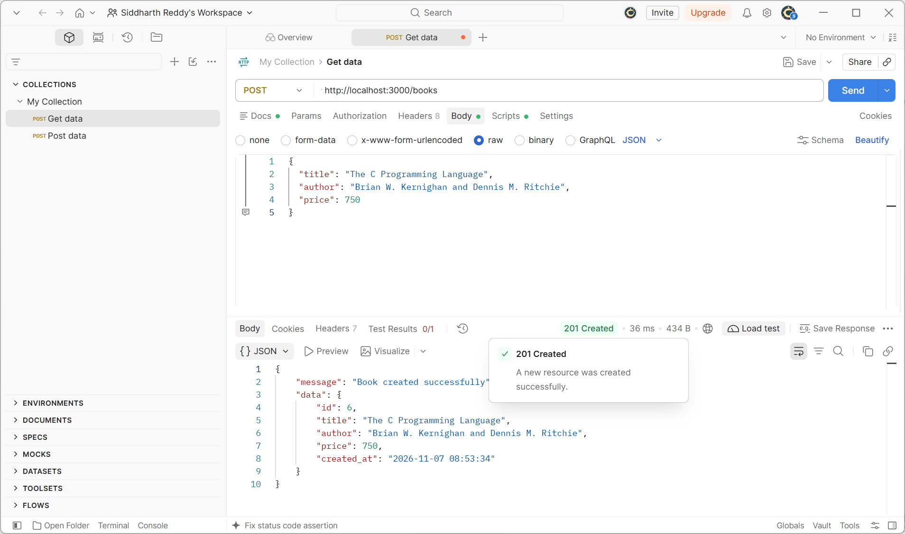

### 7. POST - Validation Error (400)

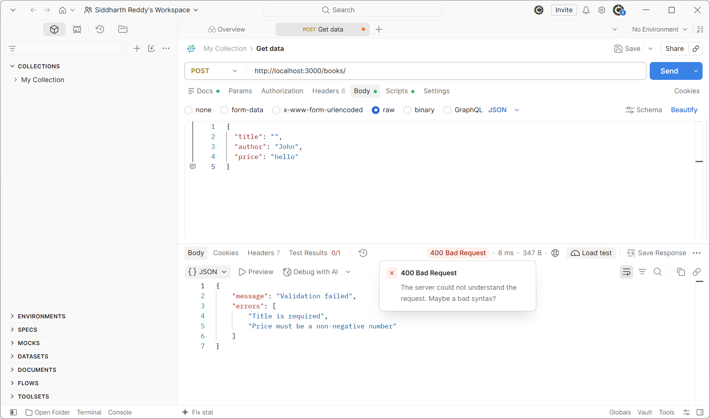

### 8. GET - Book Not Found (404)

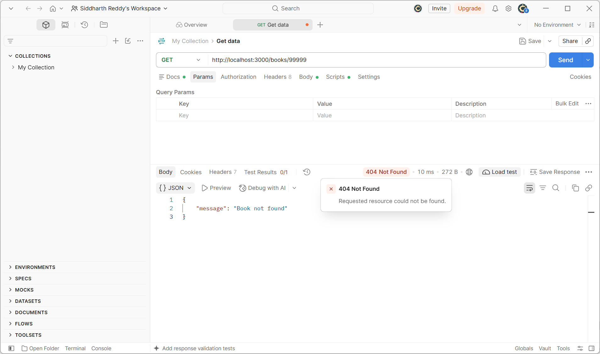

### 9. GET - Retrieve Book by ID

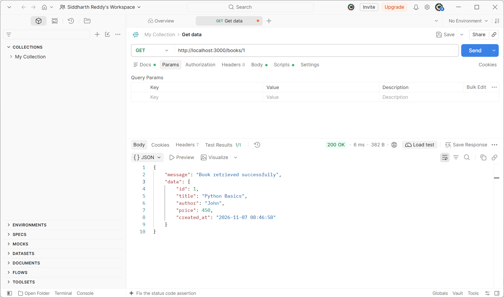

### 10. PUT - Update an Existing Book


### 11. DELETE - Delete an Existing Book

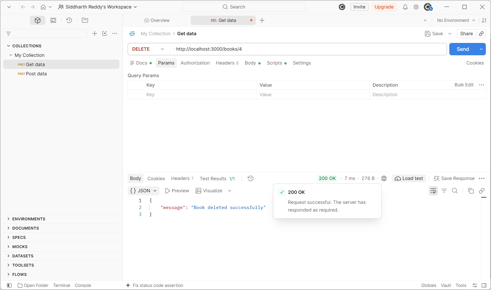

### 12. DELETE - Book Not Found (404)

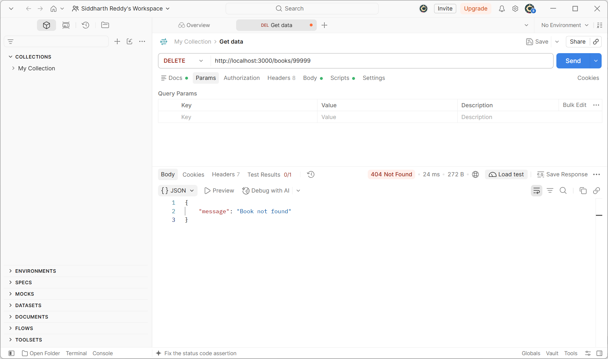

### 13. SQLite Database Records

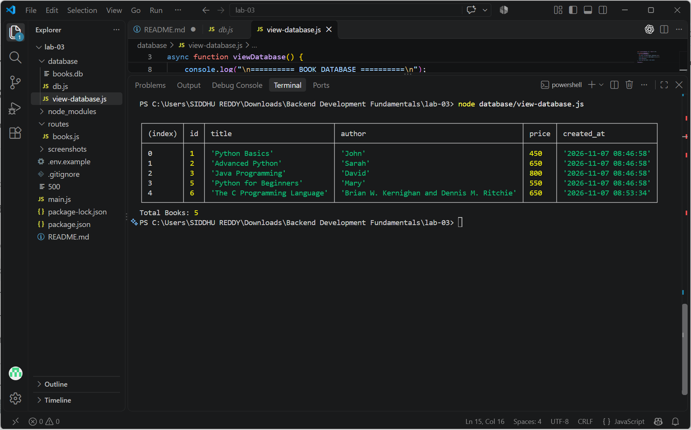

## Debugging Notes

- `EADDRINUSE`: Another process is using the port; stop it or choose another port.
- Wrong import path: Verify the relative path and filename.
- `no such table`: Verify that the SQLite table name is `books` and database initialization has completed.
- Database initialization: Used `.then()` to ensure database initialization completes before starting the Express server.

## Notes

- This project uses sql.js, which runs SQLite through WebAssembly and avoids compiling a native Node.js addon.
- SQL values use prepared statements and bound parameters.
- Sort columns are selected from an allowlist.
- Input validation is implemented to prevent invalid book records.
- Appropriate HTTP status codes and JSON responses are returned.

## Deployment

**Deployment Status:** https://backend-development-fundamentalslab3.onrender.com/.

The project currently runs locally using Node.js and Express. Postman screenshots are included to demonstrate the working API endpoints.
