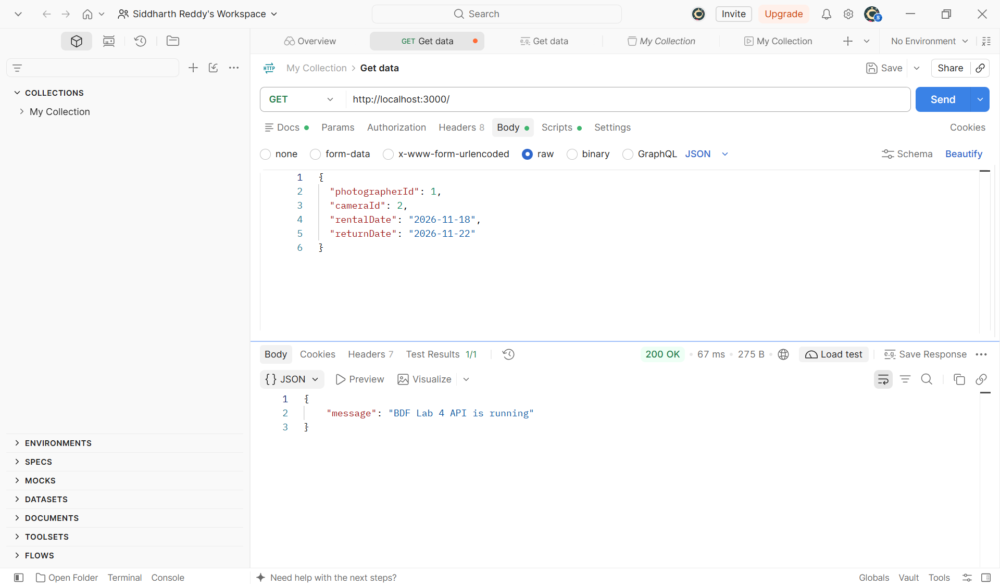
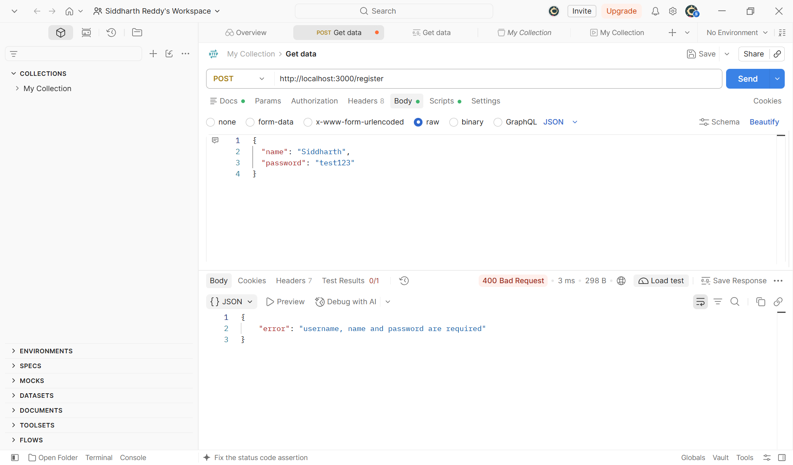
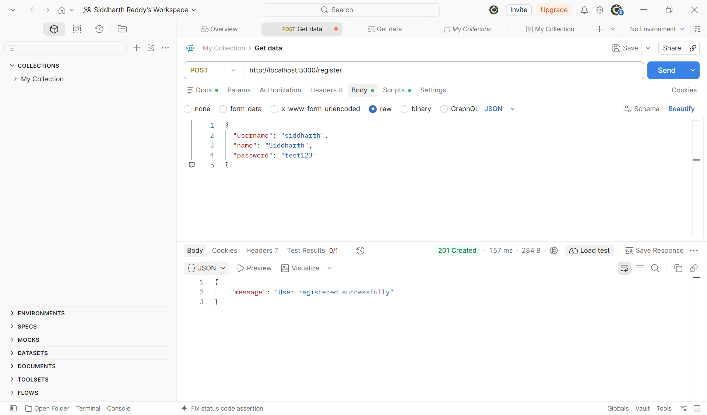
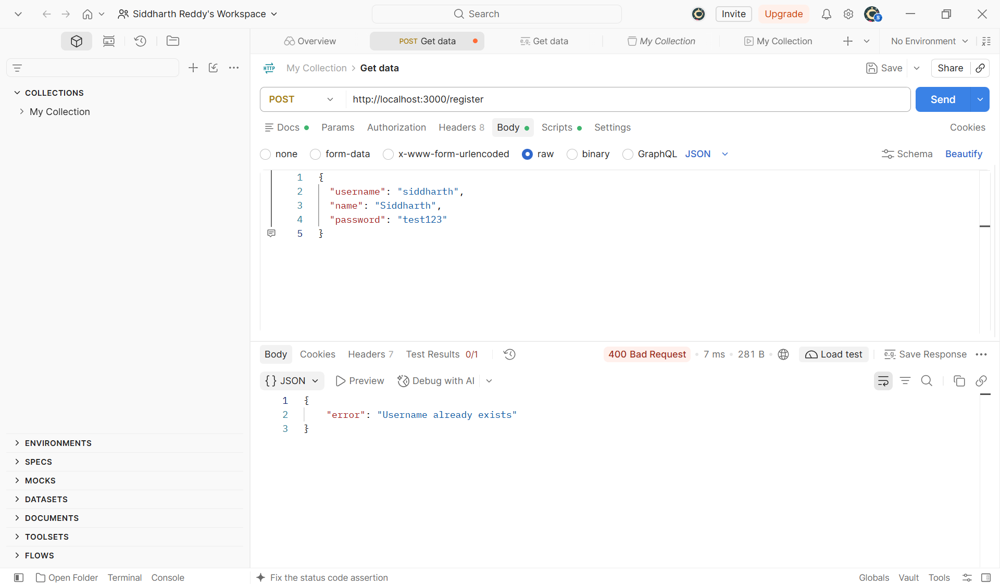
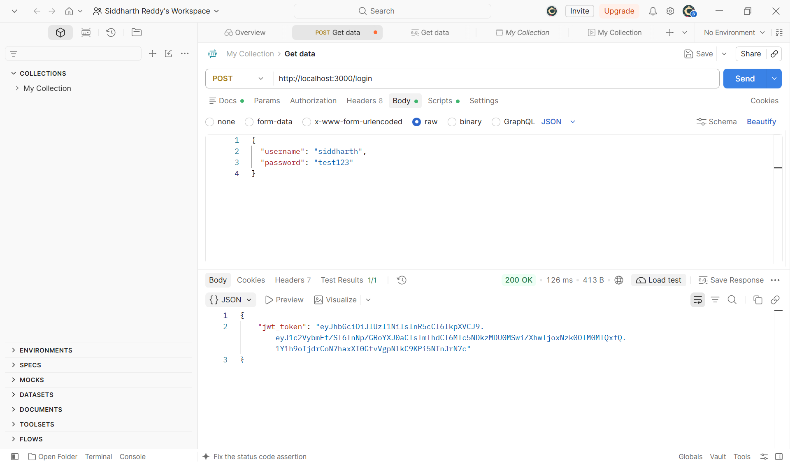
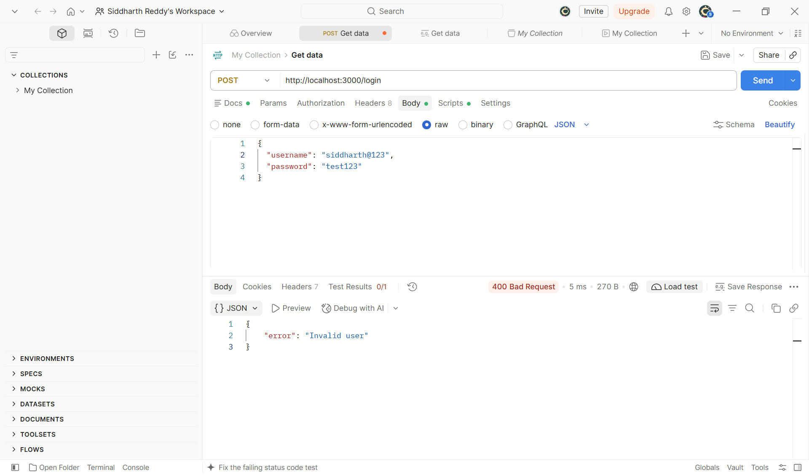
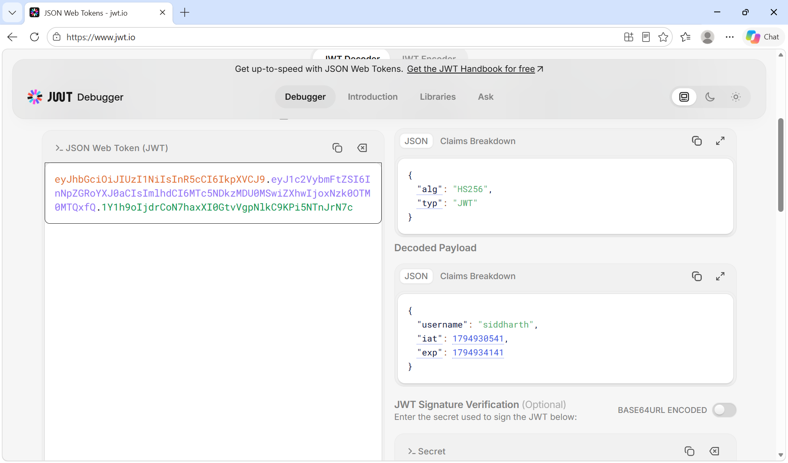
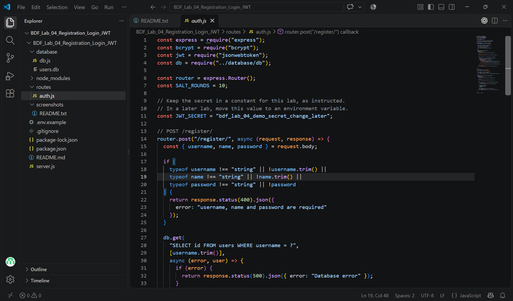

# Lab 4: Registration, login and JWT

**Name:** Enumula Siddharth Reddy
**Registration number:** 252U1R6064
**Section:** AIML-2B

## Live link
Not deployed yet.

## Overview
This project implements user registration and login using Express, SQLite, bcrypt and JSON Web Tokens (JWT). Passwords are stored as bcrypt hashes. A successful login returns a JWT containing only the username.

## Requirements
- Node.js and npm

## How to install and run

```bash
npm install
npm start
```

The server runs at `http://localhost:3000`.

The SQLite database file is created automatically at `database/users.db` when the application starts. No environment variables are required for this lab.

## Endpoints

| Method | Path | Description |
|---|---|---|
| GET | `/` | Checks whether the API is running. |
| POST | `/register/` | Registers a user and stores a bcrypt password hash. |
| POST | `/login/` | Verifies credentials and returns a JWT on success. |

## Postman testing

### 1. Register a user
**POST** `http://localhost:3000/register/`

Body: raw JSON

```json
{
  "username": "siddharth",
  "name": "Siddharth",
  "password": "test123"
}
```

Expected status: `201 Created`.

### 2. Try registering the same username again
Send the same request again.

Expected status: `400 Bad Request`.

### 3. Login with correct credentials
**POST** `http://localhost:3000/login/`

```json
{
  "username": "siddharth",
  "password": "test123"
}
```

Expected status: `200 OK`, with a `jwt_token` in the response.

### 4. Login with an incorrect password
Use the same username and a different password.

Expected status: `400 Bad Request`.

### 5. Login with an unknown username
Use a username that has not been registered.

Expected status: `400 Bad Request`.

## JWT inspection
Copy the token returned by login into [jwt.io](https://jwt.io/). Identify:
- **Header:** token type and signing algorithm.
- **Payload:** contains the username (and standard JWT time claims).
- **Signature:** verifies that the token was signed using the secret.

Do not put passwords or password hashes in the JWT payload.

## Screenshots

### Server running


### Registration validation


### Successful registration


### Duplicate username


### Successful login


### Incorrect password


### Unknown username


### JWT decoded


### Authentication code

## Notes
- The database has a unique constraint on `username`.
- SQL statements use parameterized queries.
- The JWT secret is a demo constant because the lab asks for a constant at this stage. Do not use this demo secret in a real application.
- `node_modules` and the generated database file are excluded from Git.
